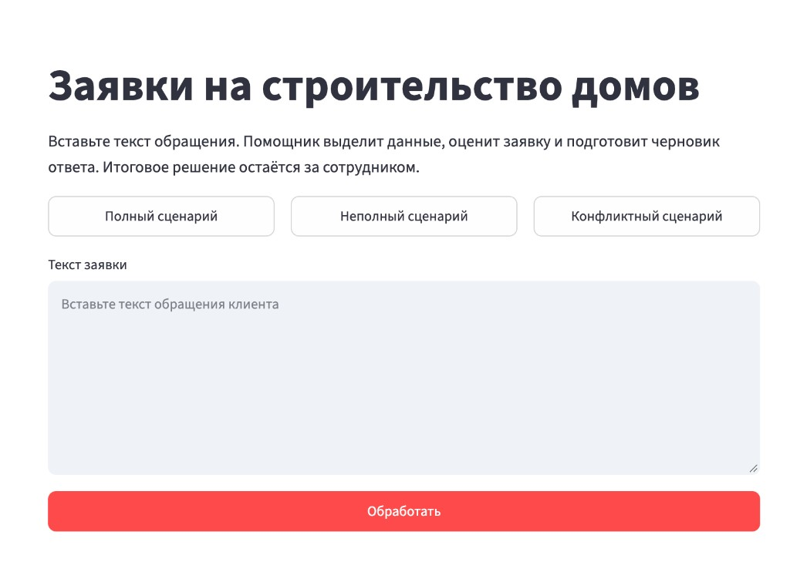
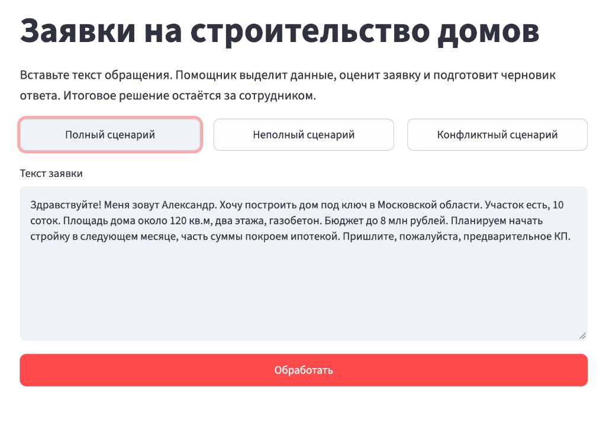
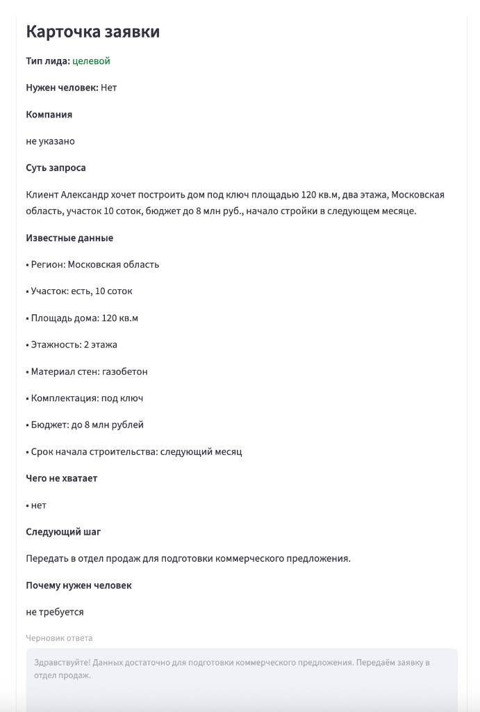

# Отчет ДЗ 2. Помощник по первичным заявкам на строительство частных домов

## Инструмент

Работа выполнена в **Cursor**. Это основной инструмент проекта.

OpenCode не использовался. Отдельно ставить VS Code, Node.js и npm не потребовалось: приложение собрано на Python и Streamlit. Cursor при этом остаётся редактором, в котором писался код, проверялся план и правилась инструкция для модели.

Ключ GigaChat получен в личном кабинете и записан только в локальный файл `.env`. В отчёт, в код и в чат ключ не входит.

## Что сделано

Собран небольшой веб-помощник для менеджера компании, которая строит частные дома под ключ. Менеджер вставляет текст заявки, нажимает «Обработать» и получает карточку, а не сырой технический ответ.

Страница на русском языке, на одном экране:

- поле для текста заявки;
- кнопка «Обработать» и индикатор ожидания;
- три кнопки с учебными заявками: полный, неполный и конфликтный сценарий;
- карточка результата с русскими названиями полей;
- понятное сообщение, если ключ не найден, нет связи или ответ модели не разобрался.

Разбор делает настоящий GigaChat. Заглушки вместо модели нет. Программа сама меняет ключ из `.env` на временный допуск и отправляет текст на актуальный адрес GigaChat. Секрет в браузер не попадает.

Базы, входа по паролю, CRM и мессенджеров нет: заявку вводят вручную.

Файлы проекта:

| Файл | Зачем |
|---|---|
| `app.py` | Страница |
| `gigachat_client.py` | Запрос к GigaChat и правила разбора |
| `samples.py` | Три учебные заявки |
| `requirements.txt` | Список библиотек |
| `.env.example` | Образец настроек без секрета |
| `.env` | Ключ на этом компьютере. В git не попадает |
| `.gitignore` | Прячет `.env` от git |
| `README.md` | Как запустить |

## Как квалифицируется заявка

- **Целевой.** Заявка про строительство дома, бюджет назван, клиент просит коммерческое предложение или готов начать в ближайший месяц.
- **Нецелевой.** Запрос не про строительство дома, например ремонт квартиры.
- **Неясно.** Тема про дом, но не хватает бюджета, этажности, срока или других данных для предложения.

Жалоба, суд и требование возврата денег передаются человеку. Цена, скидка и срок работ не обещаются, если их не было в тексте заявки.

## Слабое место и корректировка

На первых прогонах модель находила пробелы, но не помогала менеджеру отдела продаж. В коротком вопросе «сколько стоит построить дом?» она ставила тип «целевой» и обещала рассчитать стоимость. В заявке, где уже были площадь, участок и бюджет, в список попадали лишние пункты вроде фундамента, а в черновике клиенту эти вопросы не задавались. Один раз модель написала, что коммерческое предложение уже отправлено на почту, хотя этого не было в заявке.

Корректировка для агента: спрашивать только то, без чего нельзя собрать коммерческое предложение, и отдавать менеджеру одно готовое сообщение клиенту.

Закрытый список из восьми пунктов:

1. Регион или населённый пункт.
2. Участок: есть ли он и какая площадь.
3. Площадь дома.
4. Этажность.
5. Материал стен.
6. Комплектация: тёплый контур, коробка или под ключ.
7. Бюджет.
8. Срок начала строительства.

Если пункт уже есть в тексте, его не переспрашивают. Если чего-то нет, черновик просит прислать только это. Если список полный, вопросов нет и цена не называется. Жалоба не превращается в анкету для предложения.

Программа дополнительно проверяет ответ модели: чинит неровный список данных, не считает обычный запрос цены жалобой и не оставляет в черновике обещание цены или уже отправленного предложения.

## Повторная проверка

- Полная заявка Александра: тип «целевой», все восемь пунктов на месте, следующий шаг — передать в отдел продаж. Черновик без цены и без обещания звонка. Это видно на скриншотах ниже.
- «Сколько стоит построить дом?»: тип «неясно», в черновике просьба прислать недостающие пункты списка.
- Заявка по Софрино (167 м², 8 соток, тёплый контур, 7 млн, март 2027): не хватает этажности и материала стен, черновик спрашивает только их.
- Жалоба с судом и возвратом денег: нужен человек, данные для предложения не собираются, черновик нейтральный.
- Ремонт квартиры: тип «нецелевой», в отдел продаж как заявка на дом не передаётся.
- Короткая заявка «дом 127 м², проект Оазис, газобетон, стоимость тёплого контура»: сначала страница не смогла прочитать ответ модели. После правки разбора карточка строится, тип «неясно», менеджеру предлагается спросить регион, участок, этажность, бюджет и срок.

## Скриншоты

Пустая страница после запуска.



Кнопка «Полный сценарий» подставляет учебную заявку Александра.



Карточка после кнопки «Обработать»: тип «целевой», известные данные, пробелов нет, черновик без цены.



## Промпт для GigaChat

Ниже инструкция, которая уходит в модель вместе с текстом заявки. Она лежит в файле `gigachat_client.py`.

```text
Ты помощник менеджера компании, которая строит частные дома (ИЖС) под ключ.
По тексту заявки подготовь структурированный разбор для сотрудника. Ничего не выдумывай.

Верни только один JSON-объект без пояснений и без markdown. Форма:
{
  "company": "название компании клиента или «не указано»",
  "summary": "суть запроса в одном-двух предложениях",
  "lead_type": "целевой или нецелевой или неясно",
  "key_data": ["Параметр: значение из текста"],
  "missing_data": ["чего не хватает"],
  "next_step": "что сделать дальше",
  "reply_draft": "черновик ответа клиенту",
  "needs_human": false,
  "human_reason": "почему нужен человек или «не требуется»"
}

Тип лида, ровно одно из трёх значений:
- «целевой» — заявка про строительство частного дома, клиент назвал бюджет конкретной суммой, и виден ближний срок: старт стройки в ближайший месяц или раньше, либо прямая просьба прислать коммерческое предложение при уже указанных бюджете и параметрах дома. Такой запрос можно передать в отдел продаж.
- «нецелевой» — запрос не про строительство частного дома. Примеры: ремонт квартиры, отделка без стройки дома, покупка участка без строительства. Вопрос «сколько стоит построить дом» нецелевым не бывает: это заявка про дом, в которой не хватает данных.
- «неясно» — это строительство дома, но не хватает данных, чтобы решить уверенно. Если нет бюджета, этажности или срока — ставь «неясно». Срок вроде «март 2027» или «когда-нибудь потом» тоже не делает заявку целевой.

Правила фактов:
- Бери только то, что прямо написано в заявке. Если факта нет, пиши «не указано», а не догадку.
- Имя человека — не компания. Если компании нет, company = «не указано».
- В key_data перечисли только известные факты короткими строками «Параметр: значение». Не теряй участок, если он назван. Не пиши в key_data строки со значением «не указано». Чего в тексте нет — в key_data не добавляй. Если не известно ничего, верни ["не указано"].
- Не оценивай, «нормальный» ли бюджет по рынку, и не называй сумму неприемлемой. Неприемлемая цена — только если клиент прямо просит бесплатно или отказывается платить.
- Не обещай цену, срок работ, скидку, дату звонка и любые условия, которых нет во входном тексте. В reply_draft запрещены обещания: «рассчитаем стоимость», «назовём сроки», «оперативно рассчитаем», «свяжемся с вами», «ожидайте звонка».

Данные для полного коммерческого предложения. Это закрытый список, другие пункты не добавляй:
1. Регион или населённый пункт.
2. Участок: есть ли он и какая площадь.
3. Площадь дома.
4. Этажность.
5. Материал стен.
6. Комплектация: тёплый контур, коробка или под ключ.
7. Бюджет.
8. Срок начала строительства.
Не спрашивай фундамент, геологию, кадастровый номер, проект, состав семьи, отделку и телефон, если задача — собрать данные для КП.

Как заполнять missing_data и reply_draft для новой заявки на дом:
- В missing_data перечисли только пункты закрытого списка, которых нет в тексте. Если все восемь уже есть, верни ровно ["нет"], а не «не указано».
- reply_draft — одно готовое сообщение, которое менеджер отдела продаж может отправить клиенту.
- Если каких-то пунктов списка нет, попроси прислать только их, чтобы подготовить коммерческое предложение. Формулировка: «Чтобы подготовить коммерческое предложение, пришлите, пожалуйста: …». Не переспрашивай известное. Не обещай саму цену и срок стройки.
- Если все пункты списка уже есть, вопросов не задавай. Напиши только: данных достаточно, заявку передают в отдел продаж для подготовки коммерческого предложения.
- Если для квалификации не хватает бюджета, этажности или срока, lead_type = «неясно», а next_step — «Менеджеру отдела продаж отправить клиенту запрос недостающих данных для КП». Не ставь «целевой» и не ставь «нецелевой».

Жалоба, конфликт, угроза суда или отказа, требование возврата и пропавший сотрудник — эти правила важнее списка для КП:
- needs_human = true, lead_type = «неясно».
- human_reason объясняет жалобу или требование. Не пиши «не требуется».
- missing_data = ["нет"]. next_step = «Передать сотруднику». Не проси данные для КП и не пиши, что менеджер отдела продаж запросит параметры дома.
- Черновик: «Мы получили ваше сообщение и передали его сотруднику». Без возврата, расторжения, руководителя, сроков и «конструктивного решения».
- Если человек не нужен, needs_human = false и human_reason = «не требуется».
```
