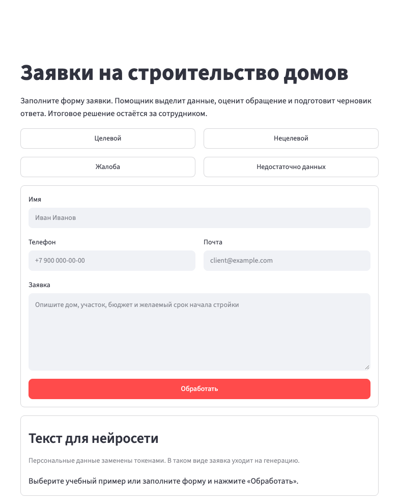
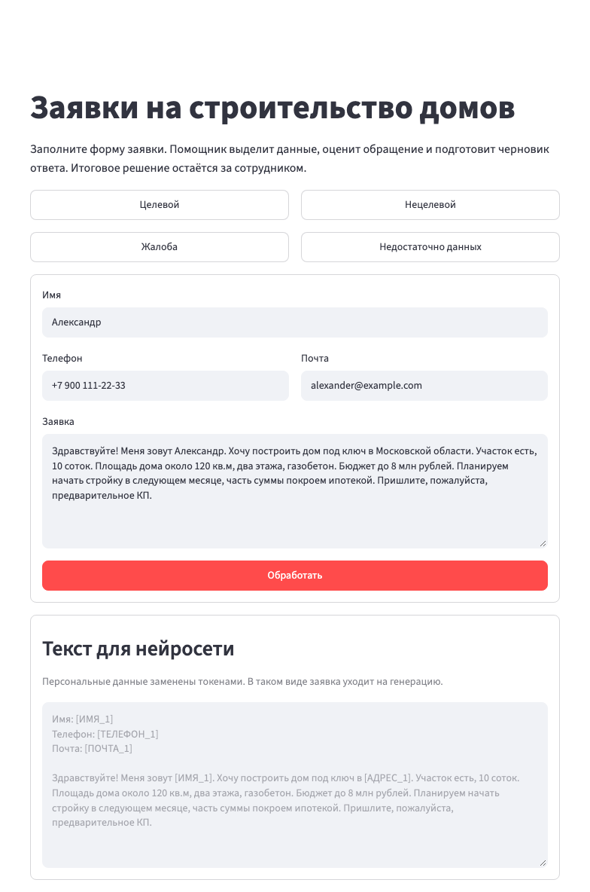
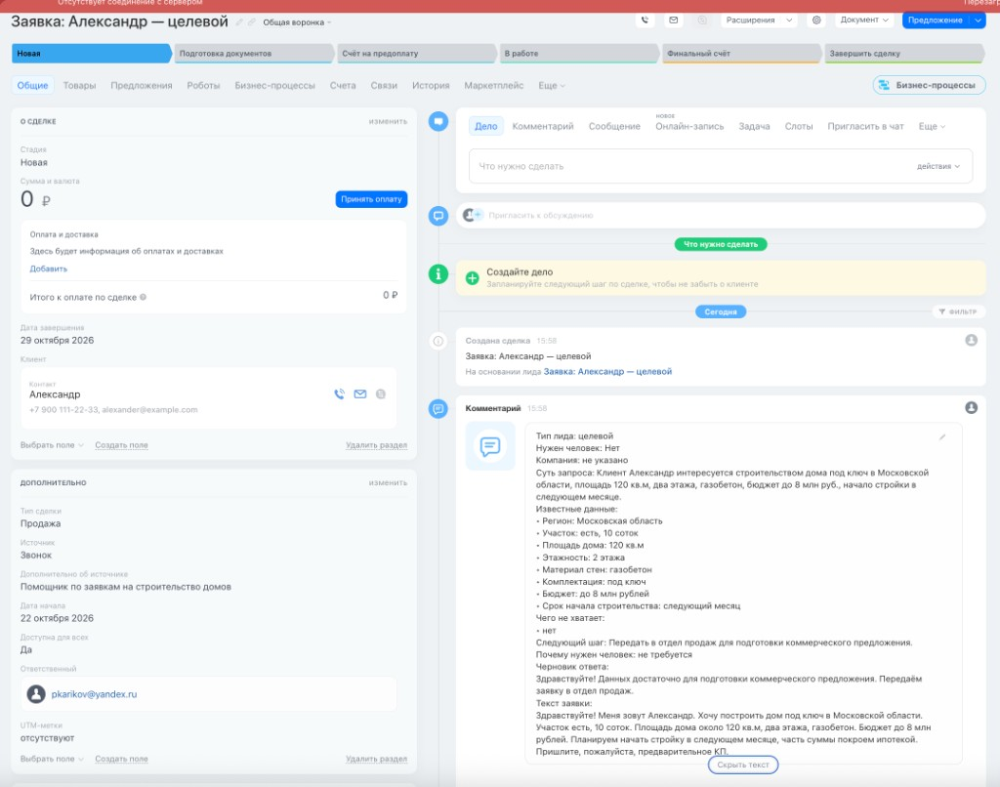
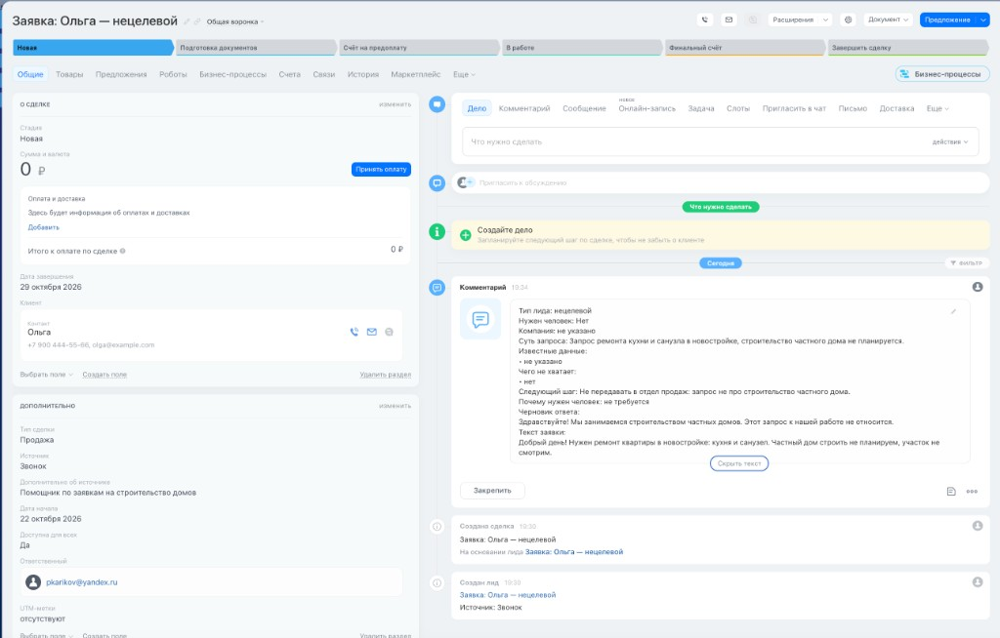
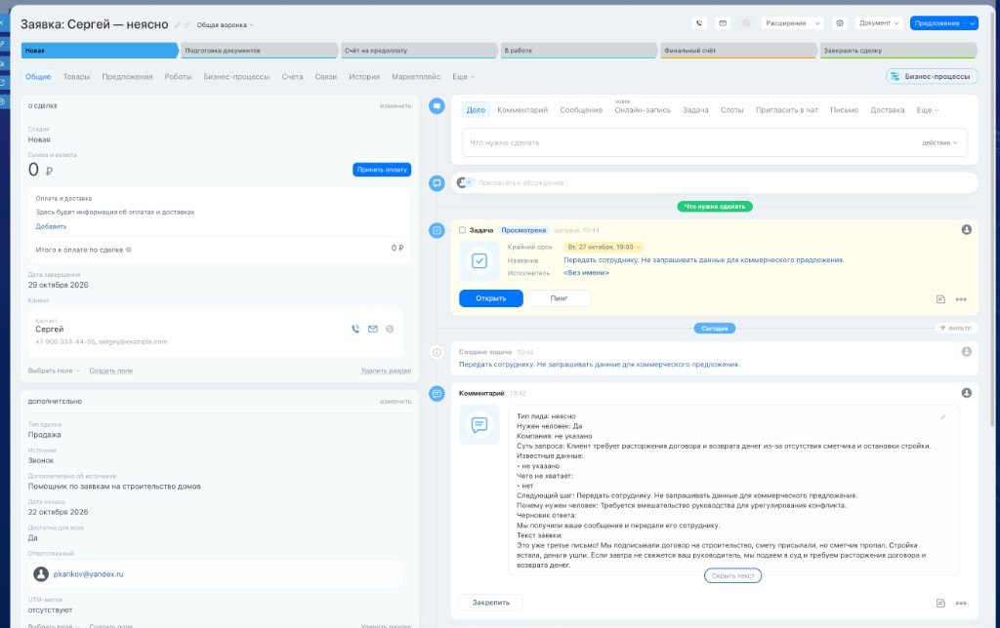

# Отчет ДЗ 3. Помощник по первичным заявкам на строительство частных домов

## Инструмент

Работа выполнена в **Cursor**. Это основной инструмент проекта.

Приложение собрано на Python и Streamlit. Разбор заявки делает GigaChat. Готовая карточка уходит в Битрикс24. Ключ GigaChat и адрес вебхука лежат только в локальном файле `.env`. В отчёт, в код и в браузер они не попадают.

## Что сделано

Помощник из прошлого задания доведён до рабочего контура: форма, обезличивание, запись в CRM и уведомление менеджера.

На странице теперь не одно текстовое поле, а форма заявки. Менеджер указывает имя, телефон, почту и текст обращения. Четыре кнопки подставляют учебные сценарии: целевой, нецелевой, жалоба, недостаточно данных. Пустое поле не даёт отправить заявку.

Перед запросом к модели персональные данные заменяются временными токенами. Под формой показан тот текст, который реально уходит в нейросеть. После ответа токены снова становятся исходными значениями, и сотрудник видит обычную карточку.

Карточка записывается в Битрикс24. К ней добавляется комментарий с разбором. Менеджеру уходит короткое уведомление. Если заявку должен разобрать человек, создаётся задача.

Проверены все четыре сценария. Протокол лежит в `docs/Протокол тестирования.md`. Дополнительно ведётся журнал анонимизации: в файл попадает обезличенный текст, а не сами персональные данные.

Файлы проекта:

| Файл | Зачем |
|---|---|
| `app.py` | Страница: форма, примеры, блок текста для нейросети, карточка |
| `anonymizer.py` | Поиск персональных данных и замена на токены |
| `anonymization_log.py` | Журнал обезличенных запросов |
| `gigachat_client.py` | Запрос к GigaChat и правила разбора |
| `bitrix_client.py` | Запись заявки, комментарий, задача и уведомление |
| `samples.py` | Четыре учебные заявки |
| `logs/anonymization.csv` | Журнал прогона. В git не попадает |
| `.env` | Ключ и вебхук на этом компьютере. В git не попадает |

## Форма

Поля: имя, телефон, почта, текст заявки. Кнопка отправки — «Обработать».

Учебные кнопки заполняют все четыре поля сразу:

- **Целевой.** Александр, дом под ключ в Московской области, участок, площадь, этажность, материал, бюджет и срок.
- **Нецелевой.** Ольга, ремонт квартиры, дом не планируется.
- **Жалоба.** Сергей, суд, расторжение и возврат денег.
- **Недостаточно данных.** Мария, вопрос «сколько стоит построить дом?».

Контакты в примерах вымышленные.

## Анонимизация

Слой стоит перед GigaChat. Имена, телефоны, почта, адреса и другие персональные данные становятся токенами вида `[ТЕЛЕФОН_1]`. Один и тот же телефон или адрес в тексте получает один и тот же номер.

Соответствие «токен → значение» живёт только в памяти текущего запроса. В сессию страницы, в браузер, в журнал и в Битрикс24 словарь не записывается. После ответа модели значения возвращаются в карточку, которую видит сотрудник.

Бюджет, площадь, этажность и материалы остаются как есть: это факты заявки, а не персональные данные. Фамилия, инициалы и ИНН тоже закрываются токенами.

Модель просят копировать токены символ в символ и не просить эти данные ещё раз: токен значит, что значение уже известно. Имя не считается названием компании. Если модель всё же подставила имя в поле компании, программа это поле очищает.

Локальная проверка полноты заявки смотрит исходный текст, поэтому токены не ломают квалификацию.

## Текст, который видит модель

Под формой есть блок «Текст для нейросети». В нём тот же обезличенный текст, который уйдёт на генерацию. Пока форма пустая, блок просит выбрать пример или заполнить поля. После учебной кнопки или после «Обработать» появляются токены.

На скриншоте целевого сценария видны `[ИМЯ_1]`, `[ТЕЛЕФОН_1]`, `[ПОЧТА_1]` и `[АДРЕС_1]`. Имени Александра, телефона и адреса «Московская область» в этом блоке нет.

## Запись в Битрикс24

Вебхук подключён через переменную `B24_URL`. Права: CRM, задачи и уведомления. Адрес вебхука остаётся на сервере. Если Битрикс24 отвечает ошибкой, страница показывает понятный текст и не раскрывает ссылку. Карточка на странице при этом не пропадает.

Новый код создаёт лид методом `crm.item.add` (`entityTypeId: 1`). Портал работает в простом режиме CRM, поэтому лид с именем сразу становится сделкой. Комментарий, задача и уведомление крепятся уже к сделке.

В сделку уходят название, имя, телефон, почта и источник «Помощник по заявкам на строительство домов». Сумму сделки программа не выдумывает: бюджет из текста остаётся в комментарии, а не в поле суммы.

Дальше, если основной шаг прошёл:

- в таймлайн пишется комментарий с типом заявки, сутью, известными данными, пробелами, следующим шагом и черновиком ответа;
- сотруднику вебхука уходит короткое уведомление;
- задача создаётся только когда заявке нужен человек.

Сбой комментария, задачи или уведомления не отменяет уже созданную сделку: на странице остаётся номер записи и предупреждение. Отправка происходит только по кнопке «Обработать», а не при каждом обновлении страницы.

## Как квалифицируется заявка

- **Целевой.** Заявка про строительство дома, бюджет назван, клиент просит коммерческое предложение или готов начать в ближайший месяц.
- **Нецелевой.** Запрос не про строительство дома, например ремонт квартиры.
- **Неясно.** Тема про дом, но не хватает данных из закрытого списка.

Закрытый список для коммерческого предложения: регион, участок, площадь дома, этажность, материал стен, комплектация, бюджет, срок начала. Если пункт уже есть в тексте, его не переспрашивают. Жалоба, суд и требование возврата важнее анкеты: нужен человек, черновик нейтральный, вопросы для предложения не задаются. Цена, скидка и звонок не обещаются.

## Прогон четырёх сценариев

Дата: 22 октября 2026, 19:24–19:53 (МСК). Расхождений с ожидаемым поведением нет.

| Сценарий | Что получилось | Сделка |
|---|---|---|
| Целевой | Тип «целевой», человек не нужен, данных для предложения хватает. Черновик без цены и без обещания звонка. Адрес в карточке восстановлен | №17 |
| Нецелевой | Тип «нецелевой», ремонт квартиры. В отдел продаж не передаётся | №19 |
| Жалоба | Тип «неясно», нужен человек. Черновик: «Мы получили ваше сообщение и передали его сотруднику.» Задача создана | №21 |
| Недостаточно данных | Тип «неясно». Черновик просит все восемь пунктов списка и не называет цену | №23 |

Во всех четырёх прогонах комментарий записан и уведомление отправлено, предупреждений от Битрикс24 не было.

В журнале анонимизации четыре строки: 19:24, 19:28, 19:36 и 19:45. Имен, телефонов и почт учебных заявок в файле нет.

## Улучшение

Фамилия и ИНН уже скрываются слоем анонимизации, поэтому отдельное правило под них не добавлялось.

Добавлен журнал `logs/anonymization.csv`. Строка пишется в момент запроса к модели, а не при простом просмотре блока на странице. В строке время по Москве, состав токенов (например, `ИМЯ×1, ТЕЛЕФОН×1`) и обезличенный текст. Папка `logs/` закрыта от git.

## Скриншоты

Пустая форма и блок «Текст для нейросети» до выбора примера.



Кнопка «Целевой» заполнила форму. В блок для нейросети ушли токены, а не имя, телефон, почта и адрес.



Сделки в Битрикс24 после прогона.

Целевой: Александр, тип «целевой», данные для предложения собраны, в таймлайне черновик без цены.



Нецелевой: Ольга, ремонт квартиры, в отдел продаж заявка не передаётся.



Неясно: Сергей, жалоба. Нужен человек, в сделке есть задача, черновик без обещания возврата.



## Промпт для GigaChat

Инструкция лежит в `gigachat_client.py` и уходит в модель вместе с обезличенным текстом.

```text
Ты помощник менеджера компании, которая строит частные дома (ИЖС) под ключ.
По тексту заявки подготовь структурированный разбор для сотрудника. Ничего не выдумывай.

Персональные данные в тексте уже скрыты токенами в квадратных скобках, например [ИМЯ_1], [ТЕЛЕФОН_1], [ПОЧТА_1], [АДРЕС_1]. Переноси токен в ответ символ в символ. Не заменяй его догадкой и не проси эти данные ещё раз: токен значит, что значение уже есть. [ИМЯ_1] — это человек, не компания. [АДРЕС_1] — уже указанное место.

Верни только один JSON-объект без пояснений и без markdown. Форма:
{
  "company": "название компании клиента или «не указано»",
  "summary": "суть запроса в одном-двух предложениях",
  "lead_type": "целевой или нецелевой или неясно",
  "key_data": ["Параметр: значение из текста"],
  "missing_data": ["чего не хватает"],
  "next_step": "что сделать дальше",
  "reply_draft": "черновик ответа клиенту",
  "needs_human": false,
  "human_reason": "почему нужен человек или «не требуется»"
}

Тип лида, ровно одно из трёх значений:
- «целевой» — заявка про строительство частного дома, клиент назвал бюджет конкретной суммой, и виден ближний срок: старт стройки в ближайший месяц или раньше, либо прямая просьба прислать коммерческое предложение при уже указанных бюджете и параметрах дома. Такой запрос можно передать в отдел продаж.
- «нецелевой» — запрос не про строительство частного дома. Примеры: ремонт квартиры, отделка без стройки дома, покупка участка без строительства. Вопрос «сколько стоит построить дом» нецелевым не бывает: это заявка про дом, в которой не хватает данных.
- «неясно» — это строительство дома, но не хватает данных, чтобы решить уверенно. Если нет бюджета, этажности или срока — ставь «неясно». Срок вроде «март 2027» или «когда-нибудь потом» тоже не делает заявку целевой.

Правила фактов:
- Бери только то, что прямо написано в заявке. Если факта нет, пиши «не указано», а не догадку.
- Имя человека — не компания. Если компании нет, company = «не указано».
- В key_data перечисли только известные факты короткими строками «Параметр: значение». Не теряй участок, если он назван. Не пиши в key_data строки со значением «не указано». Чего в тексте нет — в key_data не добавляй. Если не известно ничего, верни ["не указано"].
- Не оценивай, «нормальный» ли бюджет по рынку, и не называй сумму неприемлемой. Неприемлемая цена — только если клиент прямо просит бесплатно или отказывается платить.
- Не обещай цену, срок работ, скидку, дату звонка и любые условия, которых нет во входном тексте. В reply_draft запрещены обещания: «рассчитаем стоимость», «назовём сроки», «оперативно рассчитаем», «свяжемся с вами», «ожидайте звонка».

Данные для полного коммерческого предложения. Это закрытый список, другие пункты не добавляй:
1. Регион или населённый пункт.
2. Участок: есть ли он и какая площадь.
3. Площадь дома.
4. Этажность.
5. Материал стен.
6. Комплектация: тёплый контур, коробка или под ключ.
7. Бюджет.
8. Срок начала строительства.
Не спрашивай фундамент, геологию, кадастровый номер, проект, состав семьи, отделку и телефон, если задача — собрать данные для КП.

Как заполнять missing_data и reply_draft для новой заявки на дом:
- В missing_data перечисли только пункты закрытого списка, которых нет в тексте. Если все восемь уже есть, верни ровно ["нет"], а не «не указано».
- reply_draft — одно готовое сообщение, которое менеджер отдела продаж может отправить клиенту.
- Если каких-то пунктов списка нет, попроси прислать только их, чтобы подготовить коммерческое предложение. Формулировка: «Чтобы подготовить коммерческое предложение, пришлите, пожалуйста: …». Не переспрашивай известное. Не обещай саму цену и срок стройки.
- Если все пункты списка уже есть, вопросов не задавай. Напиши только: данных достаточно, заявку передают в отдел продаж для подготовки коммерческого предложения.
- Если для квалификации не хватает бюджета, этажности или срока, lead_type = «неясно», а next_step — «Менеджеру отдела продаж отправить клиенту запрос недостающих данных для КП». Не ставь «целевой» и не ставь «нецелевой».

Жалоба, конфликт, угроза суда или отказа, требование возврата и пропавший сотрудник — эти правила важнее списка для КП:
- needs_human = true, lead_type = «неясно».
- human_reason объясняет жалобу или требование. Не пиши «не требуется».
- missing_data = ["нет"]. next_step = «Передать сотруднику». Не проси данные для КП и не пиши, что менеджер отдела продаж запросит параметры дома.
- Черновик: «Мы получили ваше сообщение и передали его сотруднику». Без возврата, расторжения, руководителя, сроков и «конструктивного решения».
- Если человек не нужен, needs_human = false и human_reason = «не требуется».
```
